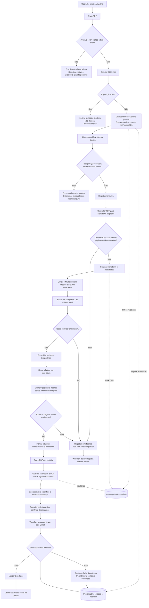

# FLUXOGRAMA.md — Do PDF ao relatório enviado

## A explicação mais simples

Pense numa esteira:

1. A pessoa coloca um PDF na entrada.
2. A esteira confere se o arquivo é válido e dá um número de protocolo.
3. O sistema transforma cada página em texto e guarda o original.
4. A IA lê o texto em partes pequenas.
5. Uma etapa confere se as páginas e as citações existem mesmo.
6. O sistema monta o relatório e o PDF.
7. O trabalho fica esperando um operador.
8. O operador decide se e para quem enviar.
9. O sistema só libera o download oficial depois que o Gmail confirma o envio.

## Fluxo principal

## O que acontece nos casos especiais

- **Arquivo duplicado:** o sistema mostra o protocolo que já existe; não inicia outro processamento automático.
- **PDF inválido ou sem texto selecionável:** encerra com erro. Esta versão não faz OCR.
- **Falha em qualquer lote ou página:** encerra como erro e não apresenta um relatório parcial como se estivesse completo.
- **Citação não encontrada, com página errada ou diferente do original:** ela aparece como pendente. Isso não impede por si só a criação do PDF nem o envio manual.
- **Falha do Gmail:** a entrega fica registrada como falha. O operador pode pedir nova tentativa controlada; o download oficial só abre após um envio confirmado.
- **Dúvida sobre o conteúdo:** o operador pode abrir o PDF original e conferir. Essa revisão é opcional para cada relatório.

## Os estados, em palavras comuns

- **Recebido:** o sistema guardou o arquivo e criou o protocolo.
- **Em processamento:** a esteira está convertendo e analisando o conteúdo.
- **Aguardando envio:** o relatório foi criado; falta o operador solicitar o e-mail.
- **Concluído:** o Gmail confirmou o envio.
- **Com erro:** uma etapa técnica não terminou. O motivo deve aparecer no histórico do protocolo.

## Uma avaliação separada

O workflow NVIDIA é um ensaio isolado: recebe apenas um texto inventado, é iniciado manualmente e não se conecta à entrada de documentos reais. Ele não substitui o Ollama, não envia PDFs à NVIDIA e deve ficar inativo depois do teste. A chave fica guardada somente nas credenciais protegidas do n8n.

## Onde cada peça mora

- **PostgreSQL:** protocolos, estados, tentativas, entregas e erros.
- **Volume privado Docker:** PDF original, Markdown paginado e relatórios Markdown/PDF.
- **n8n:** sequência de trabalho e integração com Ollama e Gmail.
- **Gateway:** entrada, login, painel, visualização e controle de download.
