# FLUXOGRAMA.md — Do PDF ao relatório enviado

## A explicação mais simples

Pense numa esteira:

1. A pessoa coloca um PDF na entrada.
2. A esteira confere se o arquivo é válido e dá um número de protocolo.
3. O sistema transforma cada página em texto e guarda o original.
4. Uma regra procura termos conhecidos e liga números de processo repetidos entre páginas.
5. A IA lê todas as páginas em partes pequenas e usa essas ligações como contexto.
6. Uma etapa confere se as páginas e citações existem mesmo.
7. O sistema monta o relatório e o PDF.
8. O trabalho fica esperando um operador.
9. O operador decide se e para quem enviar.
10. O sistema só libera o download oficial depois que o Gmail confirma o envio.

A leitura por regras registra palavras literais e trechos com páginas. Ela não
decide se um ato foi aprovado, negado ou cancelado; a repetição de um número de
processo é apenas uma pista de ligação. A lista de termos não cobre toda forma
possível de escrever um ato. Neste primeiro passo, a IA ainda analisa todos os
lotes; o sistema não limita chamadas de IA somente a casos ambíguos.

## Fluxo principal

> Este diagrama mostra como o produto deve funcionar quando estiver habilitado. Na VPS, em 26/10/2026, somente o processamento e o tratamento de erros estavam ativos. O envio e a reconciliação estavam desativados, a landing não tinha uma entrada HTTPS publicada e havia 3 documentos aguardando envio e 6 com erro. Consulte o [ROADMAP.md](ROADMAP.md) antes de tratar o fluxo desenhado como operação disponível.

```mermaid
flowchart TD
    A[Operador entra na landing] --> B[Envia PDF]
    B --> C{Arquivo é PDF válido e tem texto?}
    C -- Não --> E1[Erro de entrada ou leitura<br/>Registrar motivo e protocolo quando possível]
    C -- Sim --> D[Calcular SHA-256]
    D --> E{Arquivo já existe?}
    E -- Sim --> F[Mostrar protocolo existente<br/>Não duplicar processamento]
    E -- Não --> G[Guardar PDF no volume privado<br/>Criar protocolo e registro no PostgreSQL]
    G --> H[Chamar workflow interno do n8n]
    H --> I{PostgreSQL conseguiu reservar o documento?}
    I -- Não --> I1[Encerrar chamada repetida<br/>Evitar duas execuções do mesmo arquivo]
    I -- Sim --> J[Registrar tentativa]
    J --> K[Converter PDF para Markdown paginado]
    K --> L{Conversão e cobertura de páginas estão completas?}
    L -- Não --> X[Registrar erro técnico<br/>Não criar relatório parcial]
    L -- Sim --> M[Guardar Markdown e metadados]
    M --> M1[Gateway relê o Markdown persistido<br/>Varre termos e identificadores literais]
    M1 --> M2[Liga identificadores de processo<br/>repetidos em páginas diferentes]
    M2 --> N[Dividir o Markdown em lotes de até 6.000 caracteres]
    N --> O[Enviar um lote por vez ao Ollama local]
    O --> P{Todos os lotes terminaram?}
    P -- Não --> X
    P -- Sim --> Q[Consolidar achados e vínculos literais entre páginas]
    Q --> R[Gerar relatório em Markdown]
    R --> S[Conferir páginas e trechos contra o Markdown original]
    S --> T{Todas as páginas foram analisadas?}
    T -- Não --> X
    T -- Sim --> U[Marcar citações comprovadas e pendentes]
    U --> V[Gerar PDF do relatório]
    V --> W[Guardar Markdown e PDF<br/>Marcar Aguardando envio]
    W --> Y[Operador abre e confere o relatório se desejar]
    Y --> Z[Operador solicita envio e confirma destinatários]
    Z --> AA[Workflow separado envia pelo Gmail]
    AA --> AB{Gmail confirmou o envio?}
    AB -- Não --> AC[Registrar falha da entrega<br/>Permitir nova tentativa controlada]
    AB -- Sim --> AD[Marcar Concluído]
    AD --> AE[Liberar download oficial no painel]

    G -. original e artefatos .-> DB[(PostgreSQL: estados e histórico)]
    G -. PDF e relatórios .-> FS[(Volume privado: arquivos)]
    M -. Markdown .-> FS
    W -. relatórios .-> FS
    X --> ER[Workflow de erro registra etapa e motivo]
    AC --> DB
    AB --> DB
```

## O que acontece nos casos especiais

- **Arquivo duplicado:** o sistema mostra o protocolo que já existe; não inicia outro processamento automático.
- **PDF inválido ou sem texto selecionável:** encerra com erro. Esta versão não faz OCR.
- **Falha em qualquer lote ou página:** encerra como erro e não apresenta um relatório parcial como se estivesse completo.
- **Citação não encontrada, com página errada ou diferente do original:** ela aparece como pendente. Isso não impede por si só a criação do PDF nem o envio manual.
- **Falha do Gmail:** a entrega fica registrada como falha. O operador pode pedir nova tentativa controlada; o download oficial só abre após um envio confirmado.
- **Dúvida sobre o conteúdo:** o operador pode abrir o PDF original e conferir. Essa revisão é opcional para cada relatório.

## Os estados, em palavras comuns

- **Recebido:** o sistema guardou o arquivo e criou o protocolo.
- **Em processamento:** a esteira está convertendo e analisando o conteúdo.
- **Aguardando envio:** o relatório foi criado; falta o operador solicitar o e-mail.
- **Concluído:** o Gmail confirmou o envio.
- **Com erro:** uma etapa técnica não terminou. O motivo deve aparecer no histórico do protocolo.

## Provedor NVIDIA

O workflow NVIDIA Trial continua sendo um ensaio isolado com texto inventado,
acionamento manual e sem conexão com uploads. Ele não recebe documentos reais.

O projeto agora prevê um caminho NVIDIA NIM de produção: depois da conversão,
somente o Markdown paginado seria enviado em lotes. Esse caminho ainda não está
implementado nem ativo. Antes de usá-lo, o endpoint e a licença precisam permitir
expressamente dados governamentais; a autorização do usuário não substitui os
termos do serviço. A credencial deve ficar protegida no n8n e o relatório deve
registrar provedor/modelo. Não há fallback automático para Ollama.

## Onde cada peça mora

- **PostgreSQL:** protocolos, estados, tentativas, entregas e erros.
- **Volume privado Docker:** PDF original, Markdown paginado e relatórios Markdown/PDF.
- **n8n:** sequência de trabalho e integração atual com Ollama/Gmail, além do
  futuro endpoint NVIDIA NIM de produção após homologação.
- **Gateway:** entrada, login, painel, visualização e controle de download.
