# FLUXOGRAMA.md — Do PDF ao relatório enviado

## A explicação mais simples

Pense numa esteira:

1. A pessoa coloca um PDF na entrada.
2. A esteira confere se o arquivo é válido e dá um número de protocolo.
3. O sistema transforma cada página em texto e guarda o original.
4. Python procura menções conhecidas no texto salvo e anota a página e a linha onde aparecem.
5. A IA percorre todas as páginas em blocos e procura informações que as regras podem ter deixado passar.
6. Python confere a página e a citação de cada sugestão da IA; o que não comprovar fica de fora da síntese.
7. A IA usa as observações e sugestões aceitas para escrever o relatório.
8. O sistema confere as referências finais e gera o PDF.
9. O trabalho fica esperando um operador, que decide se e para quem enviar.
10. O download oficial só é liberado depois que o Gmail confirma o envio.

A leitura por regras registra palavras literais e trechos com páginas. Ela não
decide se um ato foi aprovado, negado ou cancelado; a repetição de um número de
processo é apenas uma pista de ligação. A lista de termos não cobre toda forma
possível de escrever um ato. A versão híbrida ainda chama a IA em todos os
lotes para procurar lacunas e também para escrever o relatório. A checagem
Python confirma que uma citação aparece no texto, não que sua interpretação
esteja correta. Essa sequência descreve o v2 híbrido. O v1 também permite
Anvisa V8 com OpenRouter, descrito no diagrama abaixo. Os exports ficam
inativos no Git; o v2 foi observado publicado na VPS em 27/10/2026, com falhas
de qualidade no teste sintético. O V8 local segue o histórico de novembro no
ROADMAP.md. Nenhum ambiente foi consultado nesta resolução de merge.

## Caminho local opcional: somente Markdown

Este caminho é separado da esteira operacional. Não cria protocolo nem muda
estados do painel; o download é texto-fonte para teste, não relatório final.

```text
Abrir 127.0.0.1:18080 → selecionar PDF textual → converter localmente
  → conferir páginas, hashes e avisos → baixar .md completo
  → eventual teste manual em serviço externo, somente com material autorizado
```

Sem n8n, banco, Ollama, API de IA ou envio de e-mail. O arquivo inclui os avisos
antes das páginas. Sem OCR: páginas sem texto não comprovam ausência de dados.

## Fluxo principal

> Este diagrama reúne o v1 com Anvisa V8 e o v2 híbrido, selecionados pelo
> workflow implantado e sua configuração. Na VPS, em 27/10/2026, o v2 e o
> tratamento de erros estavam publicados. Envio e reconciliação estavam
> inativos; havia 4 documentos aguardando envio (um sintético) e 6 com erro.
> A landing não tinha entrada HTTPS verificada. Consulte o [ROADMAP.md](ROADMAP.md) antes de tratar o fluxo desenhado como operação disponível.

```mermaid
flowchart TD
    A[Operador entra na landing] --> B[Envia PDF]
    B --> C{Arquivo é PDF válido e tem texto?}
    C -- Não --> E1[Erro de entrada ou leitura<br/>Registrar motivo e protocolo quando possível]
    C -- Sim --> D[Calcular SHA-256]
    D --> E{Arquivo já existe?}
    E -- Sim --> F[Mostrar protocolo existente<br/>Não duplicar processamento]
    E -- Não --> G[Guardar PDF no volume privado<br/>Criar protocolo e registro no PostgreSQL]
    G --> H[Chamar workflow interno do n8n]
    H --> I{PostgreSQL conseguiu reservar o documento?}
    I -- Não --> I1[Encerrar chamada repetida<br/>Evitar duas execuções do mesmo arquivo]
    I -- Sim --> J[Registrar tentativa]
    J --> RC{Retomada solicitada?}
    RC -- Não --> K[Converter PDF para Markdown paginado]
    RC -- Sim --> CP{Último checkpoint íntegro}
    CP -- Somente PDF original --> K
    CP -- Markdown salvo --> OR
    CP -- Relatório Markdown comum --> V
    CP -- Relatório V8 e ZIP --> V8R[Recuperar PDF verificado da revisão]
    V8R --> W
    CP -- PDF do relatório salvo --> W
    CP -- Artefato divergente --> X
    K --> L{Conversão e cobertura de páginas estão completas?}
    L -- Não --> X[Registrar erro técnico<br/>Não criar relatório parcial]
    L -- Sim --> M[Guardar Markdown e metadados]
    M --> OR{Workflow e provedor configurados}
    OR -- OpenRouter --> CPAI[Carregar e revalidar progresso privado da análise]
    CPAI -- Erro de integridade --> X
    CPAI -- Análise já concluída --> V8
    CPAI -- Lotes pendentes --> DENS[Selecionar lote menor ou próximo grupo de eventos]
    DENS --> CPDEP{Contexto dos lotes permite concorrência?}
    CPDEP -- Sim --> CPPOOL[Ocupar até duas vagas de API com lotes independentes]
    CPDEP -- Não --> CPSER[Despachar um lote e preservar dependências]
    CPPOOL --> CPTRAN[Enviar índice de fichas e evidências compartilhadas]
    CPSER --> CPTRAN
    CPTRAN --> TERRA[Terra aplica o V8 e devolve fichas e alterações de inventário]
    TERRA --> EXTRAN[Expandir evidências e consolidar inventário no servidor]
    TERRA -- Falha temporária --> CPRETRY{Retentativa disponível?}
    CPRETRY -- Não --> X
    CPRETRY -- Sim --> CPWAIT[Preservar lote e aguardar retentativa<br/>Vaga livre pode atender outro lote independente]
    CPWAIT --> CPDEP
    EXTRAN --> VV{Grupo, cobertura e inventário consistentes?}
    VV -- Não --> DG[Guardar bloco, resposta e diagnóstico privado]
    DG -- Falha de armazenamento --> X
    DG -- Salvo --> PC{Correção ainda disponível no grupo?}
    PC -- Não --> X
    PC -- Sim --> CR[Enviar falhas conhecidas do grupo e resposta anterior à IA]
    CR --> TERRA
    VV -- Sim --> SPAI[Salvar eventos completos e fichas em revisão separadamente<br/>Preservar IDs, evidências e histórico]
    SPAI -- Falha de armazenamento --> X
    SPAI -- Salvo --> LOT{Lote concluído?}
    LOT -- Não --> CONTIA{Há progresso e limites disponíveis?}
    CONTIA -- Sim --> DENS
    CONTIA -- Não --> X
    LOT -- Sim --> FINIA{Todos os lotes concluídos?}
    FINIA -- Não --> DENS
    FINIA -- Sim --> V8[Montar PDF com índice, fichas e ZIP de verificação]
    V8 --> W
    OR -- Ollama --> M1[Gateway relê o Markdown persistido]
    M1 --> M2[Localizar termos, identificadores, datas e durações literais]
    M2 --> N[Dividir o Markdown em lotes de até 6.000 caracteres]
    N --> O[IA analisa todos os lotes sequencialmente]
    O --> P{Todos os lotes terminaram?}
    P -- Não --> X
    P -- Sim --> HYB{Workflow híbrido v2?}
    HYB -- Sim --> Q[Python valida página, lote e citação de cada candidato]
    Q --> Q1[Separar candidatos aceitos dos pendentes]
    Q1 --> R[IA gera relatório com observações e candidatos aceitos]
    HYB -- Não --> QV1[Consolidar achados e contexto entre páginas]
    QV1 --> R
    R --> S[Conferir páginas e trechos do relatório<br/>contra o Markdown original]
    S --> T{Todas as páginas foram analisadas?}
    T -- Não --> X
    T -- Sim --> U[Marcar citações comprovadas e pendentes]
    U --> V[Gerar PDF do relatório]
    V --> W[Guardar Markdown e PDF<br/>Marcar Aguardando envio]
    W --> Y[Operador abre e confere o relatório se desejar]
    Y --> Z[Operador solicita envio e confirma destinatários]
    Z --> AA[Workflow separado envia pelo Gmail]
    AA --> AB{Gmail confirmou o envio?}
    AB -- Não --> AC[Registrar falha da entrega<br/>Permitir nova tentativa controlada]
    AB -- Sim --> AD[Marcar Concluído]
    AD --> AE[Liberar download oficial no painel]

    G -. original e artefatos .-> DB[(PostgreSQL: estados e histórico)]
    G -. PDF e relatórios .-> FS[(Volume privado: arquivos)]
    M -. Markdown .-> FS
    W -. relatórios .-> FS
    X --> ER[Workflow de erro registra etapa e motivo]
    ER --> RET[Operador clica Reprocessar no protocolo]
    RET --> CONF{Confirmar reprocessamento?}
    CONF -- Não --> OBS[Acompanhar protocolo sem iniciar tentativa]
    CONF -- Sim --> AUD[Conferir checkpoint e registrar autorização<br/>Bloquear solicitações simultâneas]
    AUD --> H
    AC --> DB
    AB --> DB
```



## O que acontece nos casos especiais

- **Arquivo duplicado:** o upload informa que o PDF já foi enviado, identifica o status como pertencente ao protocolo existente e oferece **Abrir protocolo existente**. Não inicia outro processamento automático. Cancelamento ou erro anterior permanece no histórico; uma retomada exige confirmação em **Reprocessar**.
- **PDF inválido ou sem texto selecionável:** encerra com erro. Esta versão não faz OCR.
- **Falha técnica em lote ou página:** encerra como erro e não apresenta um relatório parcial como completo. O V8 guarda os lotes e registros já validados para nova retomada.
- **Retomada após erro:** o botão Reprocessar continua do último artefato íntegro registrado, com nova tentativa e histórico preservado. Com Markdown salvo, não converte o PDF novamente. Com relatório salvo, evita uma nova análise. Resultados parciais não persistidos da IA precisam ser refeitos.
- **Checkpoint ausente ou alterado:** mostra erro de armazenamento/integridade e bloqueia a retomada. A conferência também ocorre antes do despacho pelo botão.
- **Citação não encontrada, com página errada ou diferente do original:** no Ollama aparece como pendente; no V8 o bloco precisa ser corrigido antes de gerar o PDF.
- **Rejeição V8:** guarda campo, página, motivo, evidência e resposta em diagnóstico privado associado à tentativa. Pede uma única correção direcionada por grupo; se falhar novamente, encerra com referência segura no histórico. Uma coincidência após normalizar espaços continua rejeitada.
- **Estrutura V8 inválida:** identifica campo, valor recebido e condição esperada no diagnóstico privado. Excluídos e duplicados aceitam `justificativa` compacta; incluídos e pendentes exigem `justificativa_destino` e ficha completa. O histórico de novas falhas preserva mensagem e descrição do n8n.
- **Lote V8 parcial:** solicita grupos pequenos desde a primeira chamada, reduz alvos densos e salva os eventos completos. Fichas em revisão ficam separadas e são priorizadas na continuação, preservando IDs, evidências e versões anteriores. Uma pendência explícita mantém o trabalho aberto mesmo com rótulo revisada. Ao completar 32 chamadas, o checkpoint é revalidado e o lote continua automaticamente, sem renovar os orçamentos de correção ou falta de progresso. Duas respostas sem progresso ou excesso de contexto interrompem com checkpoint guardado. A meta de 90 minutos não interrompe a duração total da análise.
- **Contexto V8:** busca identificadores literalmente no Markdown integral e entrega páginas inteiras em janelas de até 480.000 bytes de dados, incluindo continuidade e correção. A fila distingue páginas solicitadas e entregues; o restante permanece pendente na retomada. Entrega e busca literal não equivalem a revisão semântica. O lote só fecha após entregar o contexto solicitado e validar a resposta de conferência.
- **Transporte V8:** fichas concluídas sempre por índice; evidências idênticas podem compartilhar referências locais. A IA devolve alterações do inventário vinculadas à base, sem excluir unidades ou evidências. Um coordenador único reconstrói os objetos e salva os lotes sem sobrescrever outros, antes da validação final V8. Referências e versões inválidas recebem diagnóstico e uma única correção. Fichas, inventários e páginas obrigatórias permanecem integrais; o índice não comprova leitura nem relaxa a conferência. Grupos começam em oito e podem crescer a 12/16 após compactos aceitos com métricas; completas/revisões ficam em até oito. O máximo de cada chamada é conferido no servidor e a política é preservada na retomada. Até dois lotes sem contexto sobreposto podem aguardar a API em paralelo; continuações do mesmo lote são sequenciais. Lotes concluídos fora de ordem permanecem guardados e o relatório espera todos. Evidências do delta são acrescentadas por união, preservando as anteriores e a conferência literal.
- **Limites de recuperação V8:** buscas locais não consomem ampliações explícitas de páginas. Até três ampliações são admitidas desde o último avanço validado do grupo; novos registros, fichas concluídas ou cobertura/inventário concluídos reabrem esse orçamento. O pedido pendente fica salvo antes de interromper. Repetições sem trabalho novo, contexto e quantidade de buscas continuam protegendo a execução; a troca da janela de 32 chamadas não renova essas proteções.
- **Falha temporária do OpenRouter:** cada chamada tem timeout de 360 segundos e até três tentativas, com esperas de 5 e 15 segundos. Antes de repetir o mesmo pacote, revalidar o checkpoint; lotes concluídos não são refeitos. Falhas de crédito/autorização e validação não recebem esse retry. Falha persistente após a terceira tentativa termina em erro explícito com progresso salvo.
- **Retomada interna V8:** reutiliza lotes e grupos do mesmo protocolo, fonte e versão de análise, após revalidação. Estados ficam em volume privado e persistem após recriar o contêiner. Progresso antigo não salvo continua indisponível.
- **Citação candidata inválida no v2 híbrido:** Python marca como pendente e não passa o candidato para a síntese.
- **Falha do Gmail:** a entrega fica registrada como falha. O operador pode pedir nova tentativa controlada; o download oficial só abre após um envio confirmado.
- **Dúvida sobre o conteúdo:** o operador pode abrir o PDF original e conferir. Essa revisão é opcional para cada relatório.

No transporte de saída V8, campos integrais idênticos das fichas podem usar
um dicionário `campos_compartilhados` e referências locais `$campo`. Cada
referência é explícita, sem herança nem união. O servidor confere limites,
reconstrói valores e evidências e só então valida, revisa e guarda as fichas
completas. IDs, destino, páginas, justificativas e conferência de integridade
permanecem individuais. Referências inválidas não são reinterpretadas na correção.

Refinamentos explícitos dos limites do inventário conservam as chaves e
referências existentes. Citações anteriores deslocadas são guardadas em
`evidencias` no mesmo bloco/unidade, mantendo os limites novos recebidos.
Todas as evidências continuam sujeitas à conferência literal, sem promover
revisão ou resolver divergências automaticamente. Limite apagado ou evidência
removida de outro campo continua sendo erro com correção única.

Na recuperação de contexto V8, uma página entregue no passado pode estar
ausente da chamada atual. Releituras explícitas são reenfileiradas com histórico
e contador preservados, usando cache das buscas conhecidas. Pedidos vazios
permitem validar fichas da mesma resposta. Repetição de páginas presentes
e excesso de releitura sem avanço continuam rejeitados, guardando pedido,
resposta e janela no diagnóstico privado ANV8D. Paralelismo, tamanho do pacote
e validação da fonte permanecem os mesmos.

## Os estados, em palavras comuns

- **Recebido:** o sistema guardou o arquivo e criou o protocolo.
- **Em processamento:** a esteira está convertendo e analisando o conteúdo.
- **Aguardando envio:** o relatório foi criado; falta o operador solicitar o e-mail.
- **Concluído:** o Gmail confirmou o envio.
- **Com erro:** uma etapa técnica não terminou. O motivo deve aparecer no histórico do protocolo.

## Provedor NVIDIA

O workflow NVIDIA Trial continua sendo um ensaio isolado com texto inventado,
acionamento manual e sem conexão com uploads. Ele não recebe documentos reais.

O projeto agora prevê um caminho NVIDIA NIM de produção: depois da conversão,
somente o Markdown paginado seria enviado em lotes. Esse caminho ainda não está
implementado nem ativo. Antes de usá-lo, o endpoint e a licença precisam permitir
expressamente dados governamentais; a autorização do usuário não substitui os
termos do serviço. A credencial deve ficar protegida no n8n e o relatório deve
registrar provedor/modelo. Não há fallback automático para Ollama.

## Onde cada peça mora

- **PostgreSQL:** protocolos, estados, tentativas, entregas e erros.
- **Volume privado Docker:** PDF original, Markdown paginado e relatórios Markdown/PDF.
- **n8n:** sequência de trabalho e integração atual com Ollama/Gmail, além do
  futuro endpoint NVIDIA NIM de produção após homologação.
- **Gateway:** entrada, login, painel, visualização e controle de download.
